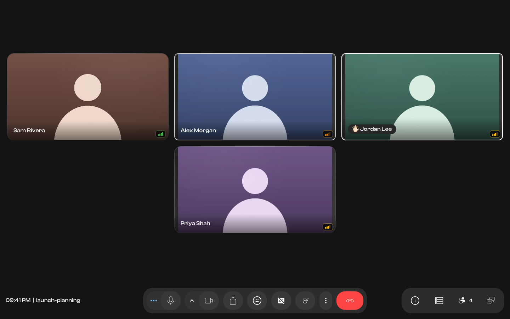

# TrueTime Meetings™ by Red5

TrueTime Meetings is a video meeting app that runs in the browser. Start a meeting, send the link, and people join
with their camera and microphone. No download or account needed. It runs on [Red5](https://www.red5.net/)'s
real-time video platform, so calls stay fast and smooth even with many people in the room.

This repository is the open source web app. You can use it as it is, host it yourself, or build your own meeting
product on top of it.



## What you can do in a meeting

- **Meet face to face**: up to 30 people on screen, with an automatic or tiled layout, and pinning to keep someone
  large.
- **Share your screen**, with sound if you want.
- **Chat** with everyone and send images, videos and PDFs.
- **React and raise your hand** without interrupting.
- **Look and sound good**: blur or replace your background, and remove background noise.
- **Record** the meeting on the server or in your own browser.
- **Turn on live captions** and get a transcript afterwards.
- **Let guests in**: hosts admit people waiting to join and can remove anyone.
- **Bring in a live stream** from outside (for example a broadcast camera) as if it were a participant.
- **Check your connection** with built-in diagnostics.

Recording, captions, external streams and sign-in are turned on by whoever runs the app, so you may not see all of
them.

## Start here

| I want to…                                  | Read                                                                                                    |
| ------------------------------------------- | ------------------------------------------------------------------------------------------------------- |
| **Use** TrueTime Meetings to join or host   | [User guide](https://www.red5.net/docs/red5-cloud/users-guide/truetime-meetings/) on the Red5 docs site |
| **Run it on my computer** to try or develop | [Getting started](docs/getting-started.md)                                                              |
| **Host it** for my team or my customers     | [Deployment](docs/deployment.md)                                                                        |
| **Change how it works** or contribute       | [Architecture](docs/architecture.md), [Contributing](docs/contributing.md)                              |

## Quick start for developers

You need Node.js 22 or later, Git, and a Red5 deployment
([Red5 Cloud](https://www.red5.net/red5-cloud/) or Red5 Pro with Stream Manager 2.0).

```bash
git clone https://github.com/red5pro/red5-truetime-meetings.git
cd red5-truetime-meetings
npm install
```

Create a `.env` file with your Red5 host:

```env
VITE_HOST="your-deployment.cloud.red5.net"
VITE_NODE_GROUP="default"
VITE_BASENAME="/"
```

```bash
npm run dev          # http://localhost:3000
```

[Getting started](docs/getting-started.md) explains each step, including the config service that issues room tokens
and turns on recording.

## Documentation

**Use it** (no technical knowledge needed)

The user guide is on the [Red5 documentation site](https://www.red5.net/docs/red5-cloud/users-guide/truetime-meetings/):

| Guide                                                                                                                               | What's in it                                                            |
| ----------------------------------------------------------------------------------------------------------------------------------- | ----------------------------------------------------------------------- |
| [Overview](https://www.red5.net/docs/red5-cloud/users-guide/truetime-meetings/)                                                     | What TrueTime Meetings is and how to deploy it from Red5 Cloud          |
| [Joining a meeting](https://www.red5.net/docs/red5-cloud/users-guide/truetime-meetings/joining-a-meeting/)                          | Starting or joining, camera permissions, the lobby, signing in, leaving |
| [In a meeting](https://www.red5.net/docs/red5-cloud/users-guide/truetime-meetings/in-a-meeting/)                                    | The control bar, chat, reactions, layouts, screen sharing, shortcuts    |
| [Camera, microphone and effects](https://www.red5.net/docs/red5-cloud/users-guide/truetime-meetings/camera-microphone-and-effects/) | Devices, backgrounds, noise suppression, video quality, diagnostics     |
| [Recording and captions](https://www.red5.net/docs/red5-cloud/users-guide/truetime-meetings/recording-and-captions/)                | Server and local recording, captions and transcripts                    |
| [Hosting a meeting](https://www.red5.net/docs/red5-cloud/users-guide/truetime-meetings/hosting-a-meeting/)                          | Host links, letting guests in, removing people                          |
| [Adding an external stream](https://www.red5.net/docs/red5-cloud/users-guide/truetime-meetings/external-streams/)                   | Bringing a live stream into a meeting as a participant                  |
| [Troubleshooting](https://www.red5.net/docs/red5-cloud/users-guide/truetime-meetings/troubleshooting/)                              | Common problems in a meeting and what fixes them                        |

**Run it**

| Guide                                      | What's in it                                               |
| ------------------------------------------ | ---------------------------------------------------------- |
| [Getting started](docs/getting-started.md) | Run the app and the config service on your machine         |
| [Configuration](docs/configuration.md)     | Every setting, where it can be set and which one wins      |
| [Deployment](docs/deployment.md)           | Docker image, Docker Compose, nginx, HTTPS                 |
| [Config service](config-service/README.md) | The small server that holds the settings and talks to Red5 |
| [Troubleshooting](docs/troubleshooting.md) | Problems running or hosting the app and what fixes them    |

**Work on it**

| Guide                                              | What's in it                                                   |
| -------------------------------------------------- | -------------------------------------------------------------- |
| [Architecture](docs/architecture.md)               | How the app is built, its pages, hooks and the APIs it calls   |
| [Using the Conference SDK](docs/conference-sdk.md) | How the app uses Red5's Conference SDK, with links to its docs |
| [Contributing](docs/contributing.md)               | Project layout, the shared UI library, tests and pull requests |

## Scripts

| Command                                | What it does                                                    |
| -------------------------------------- | --------------------------------------------------------------- |
| `npm run dev`                          | Development server on port 3000                                 |
| `npm run build`                        | Production build to `dist/`                                     |
| `npm run preview`                      | Serve the production build locally                              |
| `npm test` / `npm run test:coverage`   | Vitest                                                          |
| `npm run lint`, `npm run format:check` | Checks run on every pull request                                |
| `npm run ui:sync`                      | Use a local `../truetime-ui` checkout instead of the GitHub one |

## Built with

React 19, [MUI](https://mui.com/) 6 and Vite, the [Red5 Conference SDK](https://www.red5.net/docs/red5-cloud/development/sdks/conference-sdk/)
for video, and the shared [`truetime-ui`](https://github.com/red5pro/truetime-ui) component library that TrueTime
Meetings shares with [TrueTime Studio](https://github.com/red5pro/truetime-studio-web).

## Contributing

Issues and pull requests are welcome. Please read [Contributing](docs/contributing.md) first.

## License

Licensed under the Infrared5 example code license; see [LICENSE](LICENSE). The software may only be used with Red5 Pro, which has its own
[end user license agreement](https://account.red5.net/assets/LICENSE.txt).

For problems with this code, open an issue in this repository.
