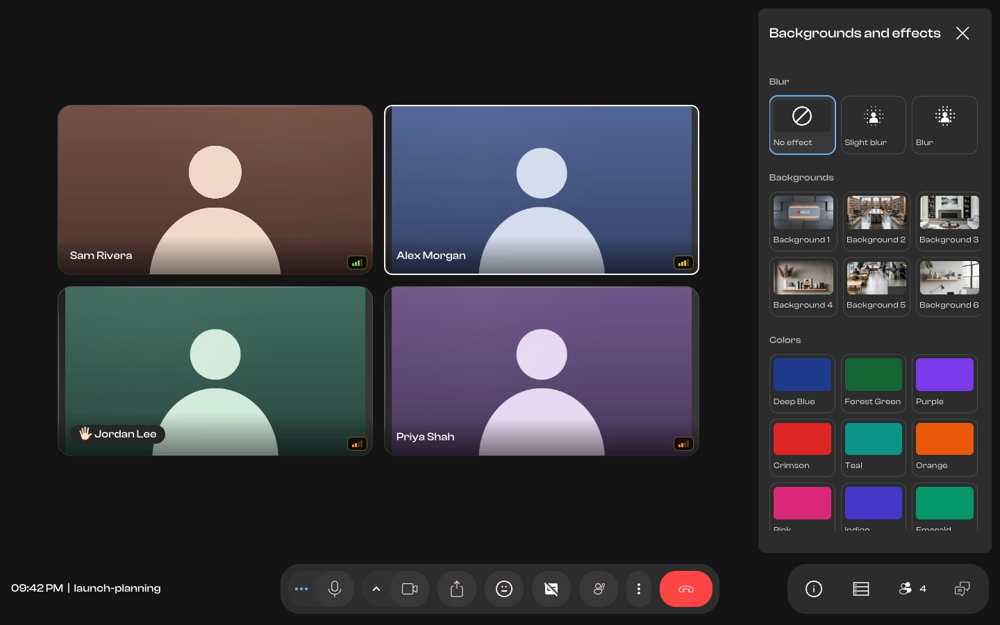
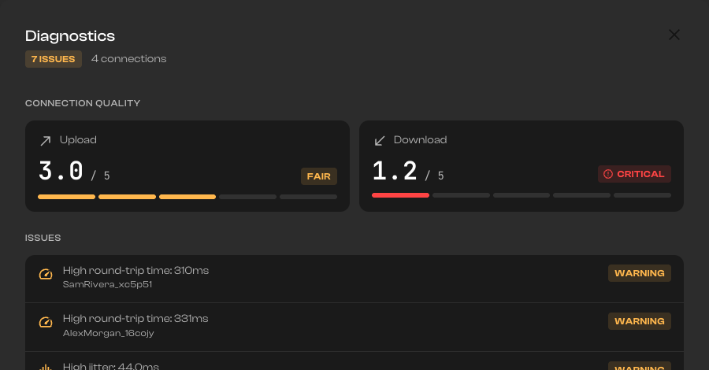

# Camera, microphone and effects

## Choosing devices

Click the small arrow next to the **Microphone** or **Camera** button in the control bar to choose:

- which **microphone** to use,
- which **speaker** or headphones to play sound through (not every browser supports this; Safari and Firefox may
  always use the system default),
- which **camera** to use, or the **front** or **back** camera on a phone.

If you unplug a device during a meeting, TrueTime Meetings switches to another one automatically.

## Backgrounds and effects

Open the camera menu and choose **Backgrounds and effects** (or **More options** → **Virtual Effects**). It's also in
the lobby before you join.

- **Blur**: **Slight blur** or **Blur** softens what's behind you. **No effect** turns effects off.
- **Backgrounds** replace it with an image your organization provides.
- **Colors** replace it with a plain color.

Your camera has to be on to use effects. Effects run on your own device, so they may use more battery and slow down
older computers.

## Noise suppression

Noise suppression removes background sounds such as typing, traffic or a fan, while keeping your voice. It runs on
your own device. Find it in the microphone menu or in **More options** → **Audio Settings**:

- Turn it on or off.
- Choose how much noise to remove. More removes more noise, but voices can start to sound robotic over very loud
  backgrounds. Your organization sets the starting level (20% unless changed).

The first time you use it, the noise suppression model downloads (**Downloading the noise suppression model**),
which can take a few seconds.

## Video quality

**More options** → **Video Settings** → **Outgoing Video Quality Limit** caps how much data your camera sends. Lower it if your
internet connection is slow or others see your video freeze. Higher looks sharper but needs a faster connection.

## Checking your connection

**More options** → **Diagnostic** rates your upload and download out of 5 and lists any issues it finds, such as
high round-trip time (delay) or jitter (uneven delivery), with the connection each one affects. Below that it shows
the details of every connection: packet loss, jitter, round-trip time and bitrate.

If a developer is helping you, **Print detailed statistics to the browser console** gives them more detail.
**More options** → **Report Problem** opens Red5's support portal.

**Tips for a better call**

- Use a wired connection or sit close to your Wi-Fi router.
- Close other apps and tabs that use video or the network.
- Lower the outgoing video quality.
- Turn off background effects on an older computer.

More fixes are in [Troubleshooting](../troubleshooting.md).
