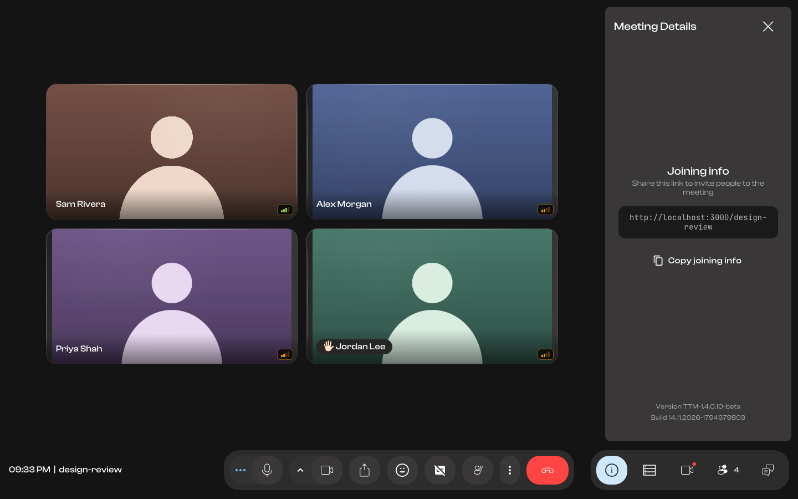
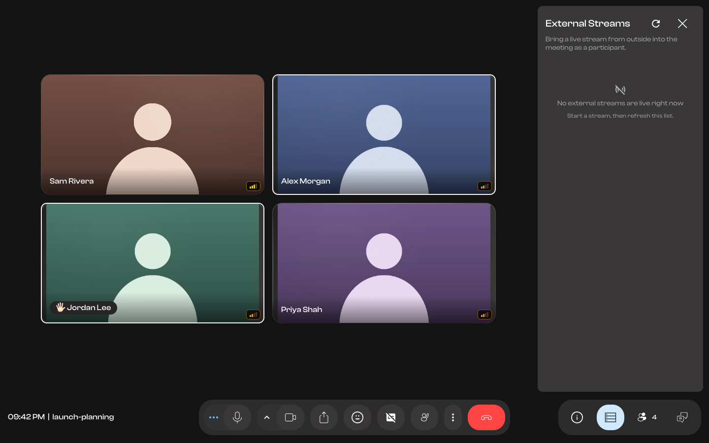

# Hosting a meeting

A host runs the meeting: they let guests in and can remove people. Hosts join with a host link.

## Links for different roles

The meeting link decides what you can do. The person or system that sets up your meetings adds a `role` to the link:

| Link ends with   | You join as | What you can do                                                  |
| ---------------- | ----------- | ---------------------------------------------------------------- |
| _(nothing)_      | Participant | Camera, microphone, chat, screen sharing                         |
| `?role=admin`    | Host        | Everything a participant can, plus admitting and removing people |
| `?role=observer` | Viewer      | Watch and listen only, without a camera or microphone            |
| `?playOnly=true` | Viewer      | Watch and listen only                                            |

For example: `https://meet.example.com/meetings/team-sync?role=admin`.

Links can also carry a `token` that the organization's server creates to control who may join. Keep host links
private.

To invite people, open **Meeting details** and click **Copy joining info**. If you joined with a host link, check
the copied link before you share it: remove `?role=admin` so you don't hand out host rights.

## Letting guests in

When sign-in is required, people who choose **Join as Guest** wait until a host admits them. You'll see them in
**Participants** under **Waiting to join**. Click **Admit** to let them in or **Deny** to turn them away.

## Removing someone

Open **Participants**, find the person (you can search by name) and choose **Remove from meeting**. Only hosts can
remove people, and you can't remove yourself.

## Bringing in a live stream

**External streams** lets you add a live stream from outside the meeting, such as a broadcast camera, an encoder
like OBS, or another Red5 stream, so it shows up as if it were a participant.

1. Start the stream on your Red5 deployment.
2. Open **External streams** in the control bar. Live streams are listed, the ones already in the meeting first,
   with how long they've been live.
3. Click **Add**. Click **Remove** to take it out again.

If your stream isn't listed, click the refresh button at the top of the panel. External streams must be turned on by whoever runs your TrueTime
Meetings.

## Before a big meeting

- Join a few minutes early with the host link and check your camera, microphone and connection
  (**More options** → **Diagnostic**).
- Decide whether to record, and tell people at the start.
- Share the right link with each group: participants, guests, and viewers who only watch.
