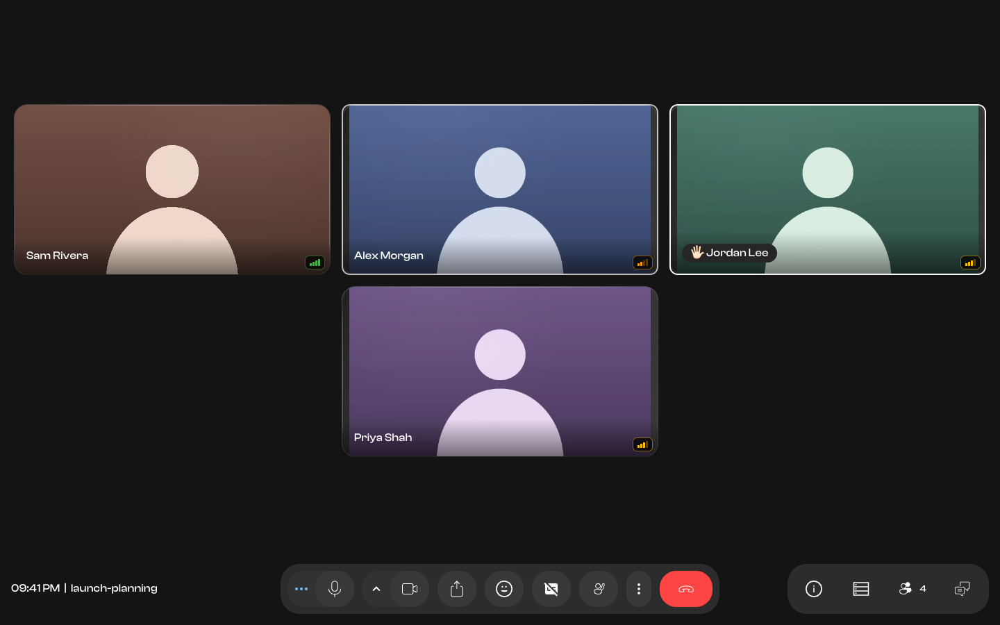
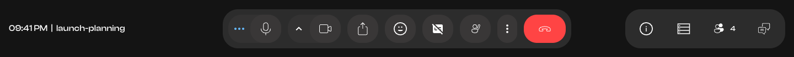
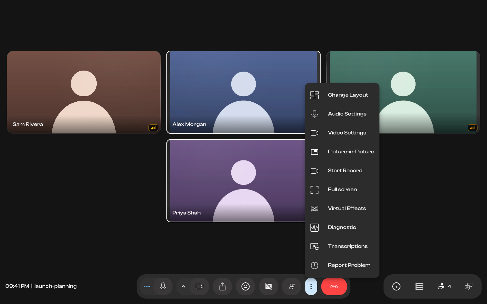
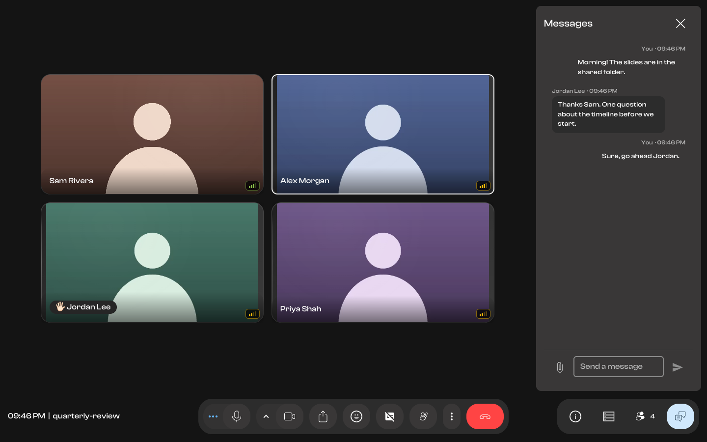
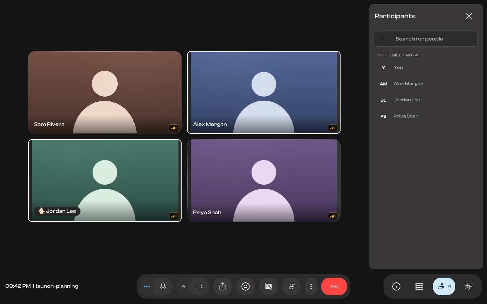
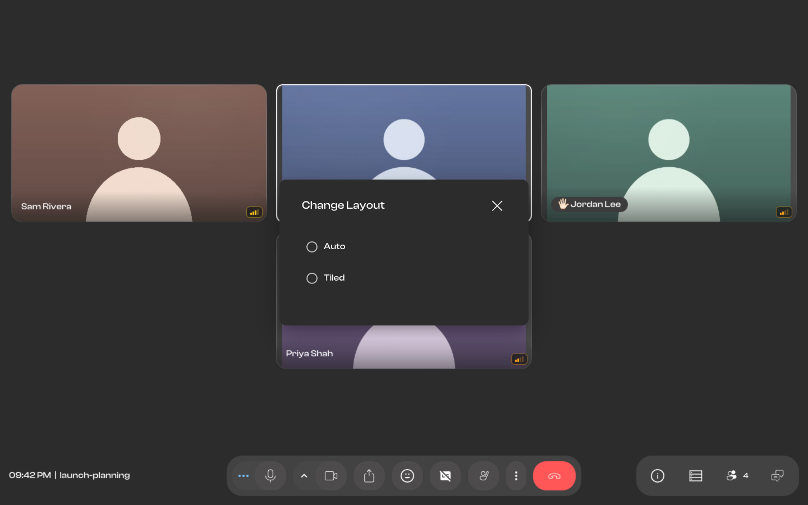
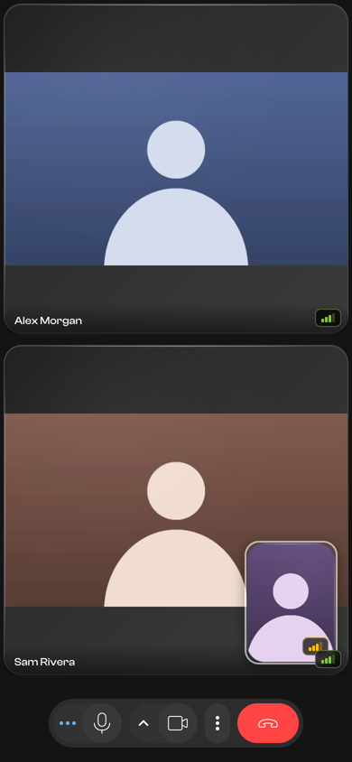

# In a meeting

Each person's video shows their name and a connection indicator (green is good, orange or red means a weak
connection). A hand next to a name means that person has raised their hand.

## The control bar

The bar at the bottom of the screen holds the main controls. On a narrow screen or a phone, some of them move into
the **More options** (⋮) menu.

From left to right in the middle:

| Control              | What it does                                                           |
| -------------------- | ---------------------------------------------------------------------- |
| **Microphone**       | Mute or unmute. The arrow next to it picks the microphone and speaker. |
| **Camera**           | Turn your camera on or off. The arrow next to it picks the camera.     |
| **Present now**      | Share your screen, a window or a browser tab.                          |
| **Reactions**        | Send an emoji that floats over your video.                             |
| **Captions**         | Show or hide live captions (if turned on for your organization).       |
| **Raise hand**       | Let others know you'd like to speak. Click again to lower it.          |
| **More options** (⋮) | Everything else; see below.                                            |
| **Leave call**       | Leave the meeting.                                                     |

On the right:

| Control              | What it does                                                                                                 |
| -------------------- | ------------------------------------------------------------------------------------------------------------ |
| **Meeting details**  | The meeting link, **Copy joining info**, and the app version.                                                |
| **External streams** | Live streams you can bring into the meeting (see [Hosting](hosting-a-meeting.md#bringing-in-a-live-stream)). |
| **Participants**     | Everyone in the meeting, with the number of people next to the icon.                                         |
| **Chat**             | Messages to everyone in the meeting, with a counter for unread messages.                                     |

While you're recording on your own device, a **Local recording** button also appears here (see
[Recording](recording-and-captions.md#local-recordings)).

The room name and the time are on the left.

## More options

| Item                   | What it does                                                                                                            |
| ---------------------- | ----------------------------------------------------------------------------------------------------------------------- |
| **Change Layout**      | Auto or tiled layout (see [Layouts](#layouts))                                                                          |
| **Audio Settings**     | Microphone, speaker, noise suppression and push to talk                                                                 |
| **Video Settings**     | Camera and outgoing video quality                                                                                       |
| **Picture-in-Picture** | Keep the meeting in a small floating window while you work in other apps                                                |
| **Start Record**       | Record the meeting (see [Recording](recording-and-captions.md))                                                         |
| **Full screen**        | Hide the rest of your browser                                                                                           |
| **Virtual Effects**    | Blur or replace your background                                                                                         |
| **Diagnostic**         | Check your connection (see [Camera, microphone and effects](camera-microphone-and-effects.md#checking-your-connection)) |
| **Transcriptions**     | A written record of what was said                                                                                       |
| **Report Problem**     | Open Red5's support portal                                                                                              |

## Chat

Open **Chat** to send messages to everyone in the meeting. Use the paperclip to attach images, videos and PDFs up
to 5 MB each. When the chat is closed, new messages pop up briefly and a counter shows how many you haven't read.

## Participants

**Participants** lists everyone in the meeting, starting with you, then people with a raised hand. Search by name
at the top. Hosts also see people waiting to join, and can remove people (see
[Hosting a meeting](hosting-a-meeting.md)).

## Sharing your screen

Click **Present now** and choose what to share: your entire screen, one window, or a browser tab. To share sound
too (for a video, say), share a tab and tick the browser's option to share its audio. Click **Stop presenting**
when you're done.

## Layouts

Open **More options** → **Change Layout** to choose how videos are arranged:

- **Auto** adapts to the number of people. With one other person, they fill the screen and your own video floats
  in a corner.
- **Tiled** shows everyone, including you, in a grid of equal tiles.

You can also set how many tiles are shown at most. People who don't fit go into an **Others** tile, and you still
hear them.

To keep one person large, hover over their video and click the **pin** button. The pinned person fills the screen
and everyone else moves into a strip beside them. Click it again to unpin.

## Keyboard shortcuts

| Key            | What it does                                                           |
| -------------- | ---------------------------------------------------------------------- |
| Hold **Space** | Push to talk: unmutes you while you hold it, mutes you when you let go |
| **C**          | Show or hide captions                                                  |

Push to talk is turned on in **More options** → **Audio Settings**. Shortcuts don't fire while you're typing in the
chat or another text field.

## On a phone or tablet

TrueTime Meetings works in mobile browsers. Videos stack to fit the screen, your own video floats in a corner, and
less-used controls sit in the **More options** menu. You can switch between the front and back camera.

