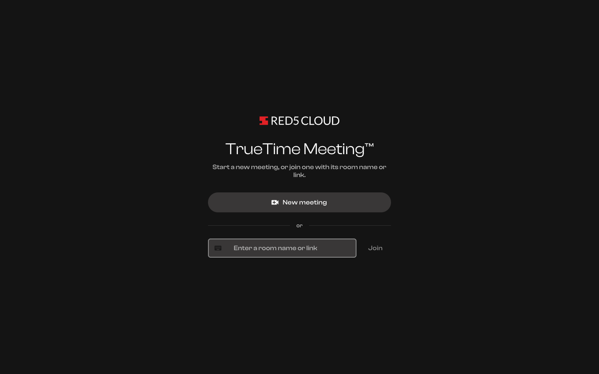
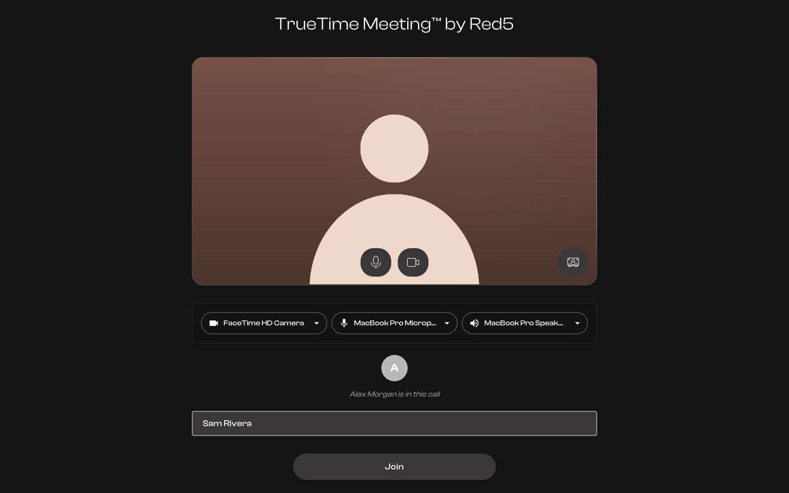

# Joining a meeting

## Start a new meeting

1. Open TrueTime Meetings in your browser.
2. Click **New meeting**. A room with a random name is created and you go straight to the lobby.
3. Once you're in, open **Meeting details** in the control bar and copy the link to invite others.

## Join a meeting

- **From a link**: click the link you were sent. It opens the meeting's lobby.
- **From the home page**: type the room name, or paste the whole link, into **Enter a room name or link** and click
  **Join**.

Anyone with the link can join, so share it only with the people you want in the meeting.

## Allow your camera and microphone

The first time you join, your browser asks whether TrueTime Meetings may use your camera and microphone. Click
**Allow**.

If you clicked **Block** by mistake:

1. Look for the camera or microphone icon in your browser's address bar.
2. Click it and choose **Allow**.
3. Click **Try again** on the page.

## The lobby

Before you enter, the lobby shows a preview of your camera and who is already in the call. Here you can:

- type **Your name**, which others see under your video,
- turn your camera and microphone on or off,
- choose which camera, microphone and speaker to use,
- try a background or blur with the button in the corner of the preview (see
  [Camera, microphone and effects](camera-microphone-and-effects.md)).

Click **Join** when you're ready (the button says **Start Call** if no one is there yet). You can change all of
these settings during the meeting too.

## Signing in and joining as a guest

Your organization may require you to sign in with Google before joining. On the sign-in page you can:

- **Sign in with Google**, or
- **Join as Guest**. Guests ask to join and wait (**Waiting for approval…**) until a host lets them in.

## Leaving

Click the red **Leave call** button. On the next page you can **Rejoin** the same meeting or **Return to home
screen**.

## Joining to watch only

If you were sent a link to watch rather than take part, you join without a camera or microphone. You see and hear
everyone, but others don't see you. See [Hosting a meeting](hosting-a-meeting.md#links-for-different-roles).
