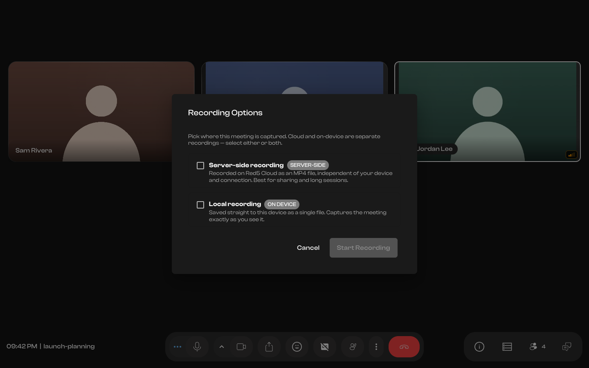
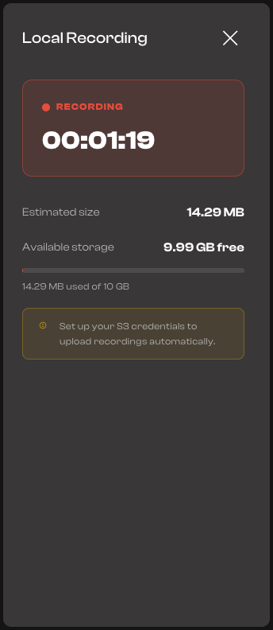
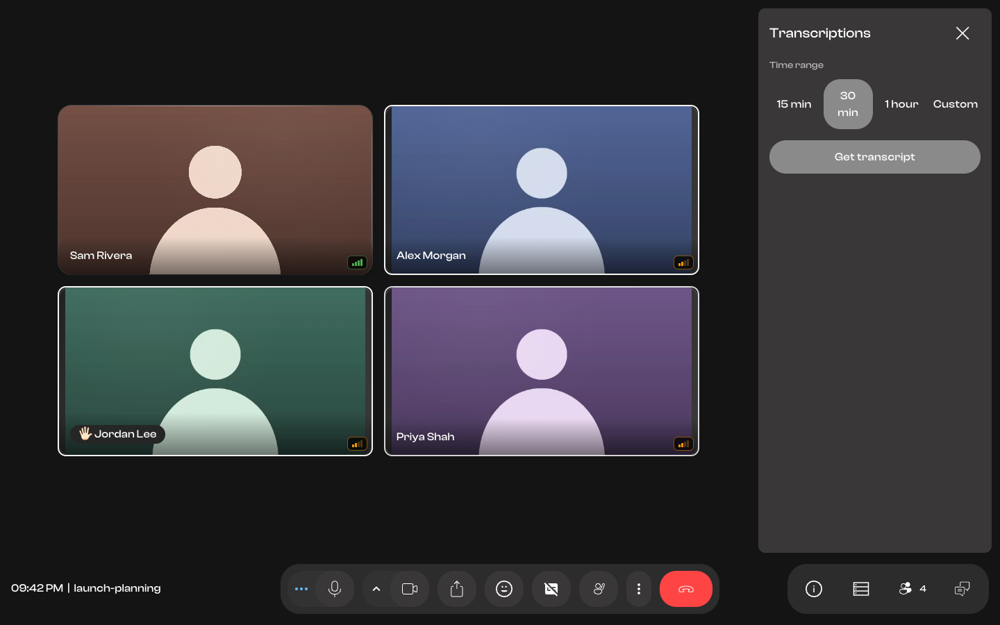

# Recording and captions

Server recording and captions are only available if your organization has turned them on. If they're off, the
buttons are greyed out.

Let people know before you record a meeting.

## Starting a recording

**More options** → **Start Record** opens the recording options. Tick where to record, either or both, then click
**Start Recording**.

- **Server-side recording** records the meeting on Red5's servers, so it keeps going even if your own connection
  drops. You can record the grid view as one MP4 file, or each person separately.
- **Local recording** saves the meeting to your own computer, exactly as you see it, with nothing stored on a
  server. It's available to everyone.

A recording indicator shows while it runs. **More options** → **Stop Record** finishes it.

## Server recordings

Where server recordings go is set up by whoever runs your TrueTime Meetings; ask them for your recordings.

## Local recordings

While a local recording runs, a **Local recording** button (a camera with a red dot) appears on the right of the
control bar. It opens a panel with the recording time, the file's estimated size and the storage left on your
device. From there you can pause, resume, stop and **Download Recording**.

Keep the tab open until the recording is saved. If your organization has set up cloud storage (Amazon S3),
recordings upload there automatically; keep the tab open until **Upload Successful** appears. Otherwise the panel
reminds you that uploads aren't set up, and you download the file yourself.

## Live captions

Click **Captions** in the control bar (or press **C**) to show what people say as text at the bottom of the screen.
Captions start when your microphone is on.

## Transcripts

**More options** → **Transcriptions** shows a written record of what was said, in order, with each person's name.
Pick a time range (15 minutes, 30 minutes, an hour or your own), click **Get transcript**, then **Copy transcript**
to paste it somewhere else.

